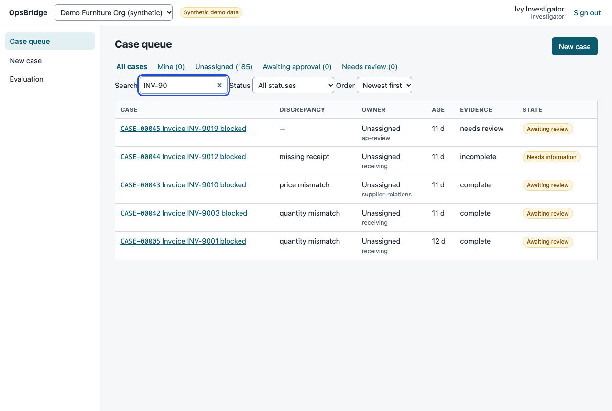
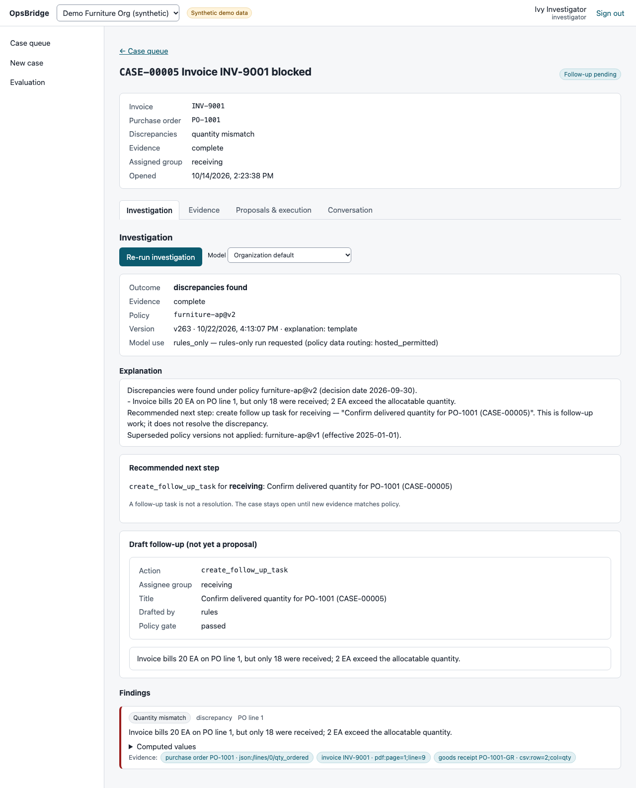
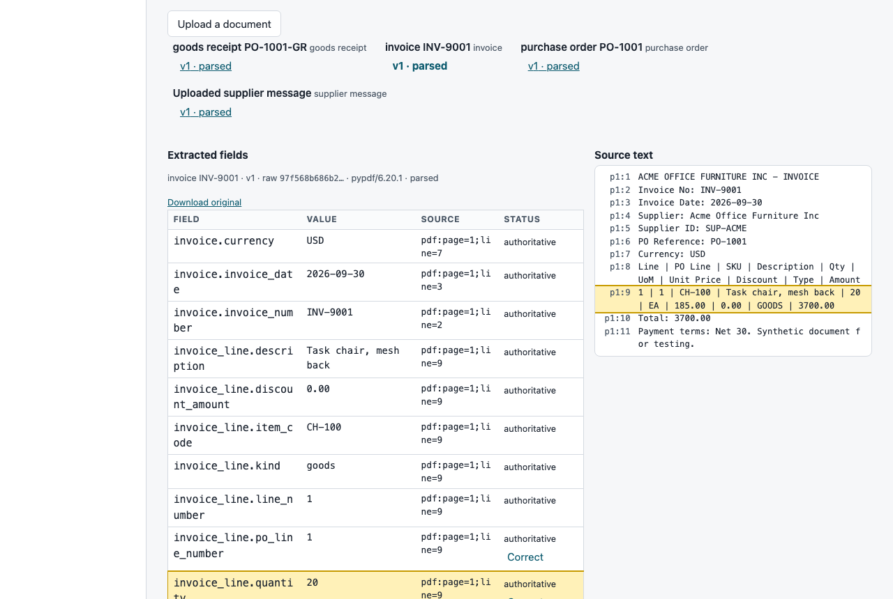
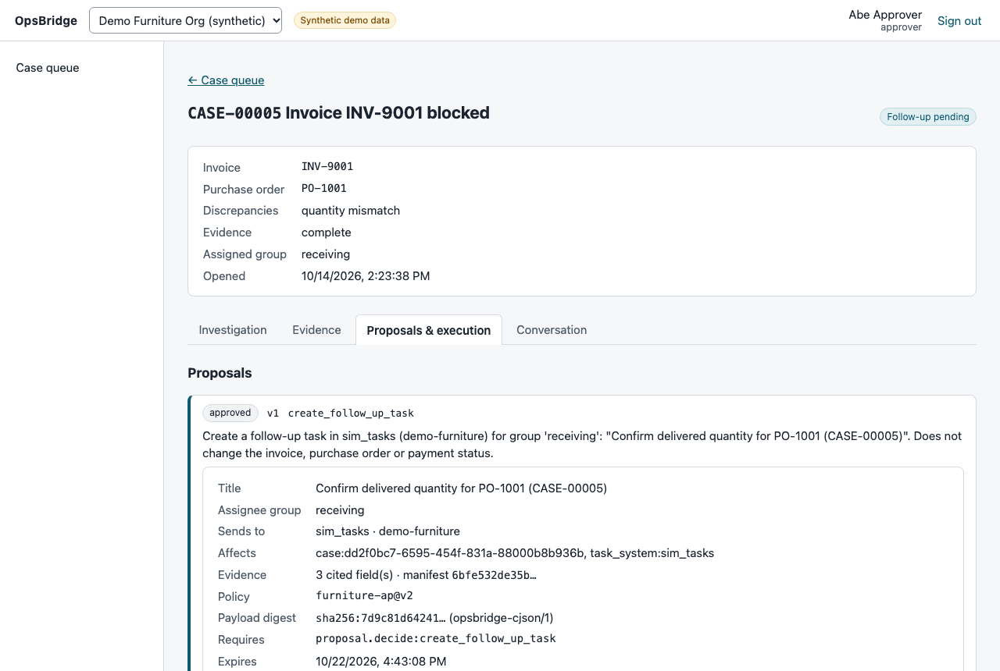
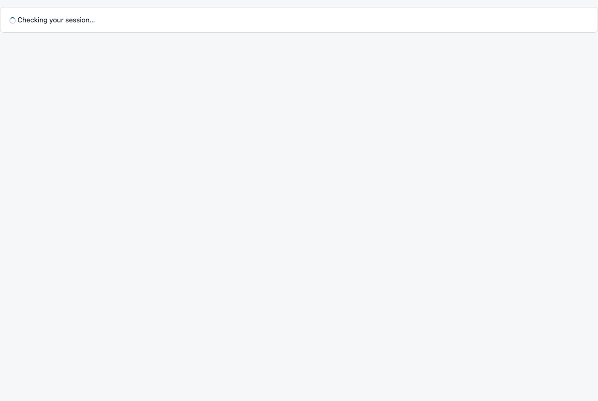
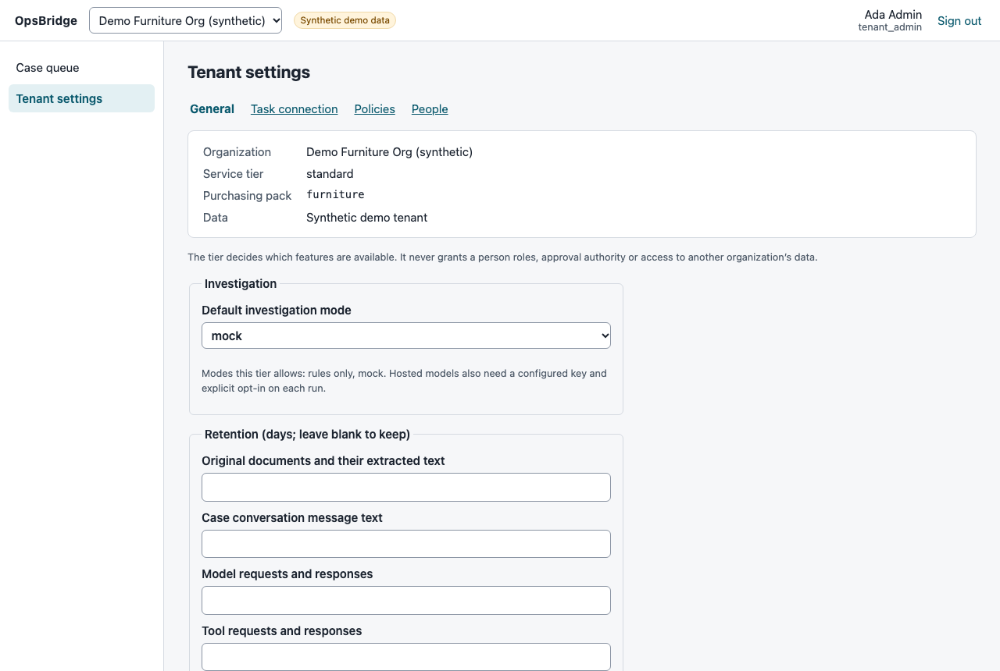

# Ops_Bridge
AI procurement exception investigation with evidence-backed findings, human-approved actions, reliable tool execution, and verifiable evaluation receipts

OpsBridge helps an accounts-payable or procurement investigator work out why an invoice is
blocked — a missing goods receipt, a quantity mismatch or a price mismatch — and take the
correct, evidenced next step. It reads the purchase order, receipts, invoice and supplier
messages, matches them with deterministic rules, cites every finding to the exact document
line, optionally lets a model explain and draft (never decide), and executes a follow-up
only after a different person approves the exact version they reviewed.

> All data in this repository and in the screenshots is synthetic. OpsBridge has not been
> used with real customer data, deployed to a cloud, or validated with a real model or by
> operators. See "Status" below before drawing conclusions.

| Case queue | Investigation with cited findings |
|---|---|
|  |  |
| **Evidence: cited line highlighted beside extracted fields** | **Proposal bound to version, digest, policy and expiry** |
|  |  |
| **Benchmark runs with intervals and receipts** | **Tenant settings: tier gates features, not authority** |
|  |  |

## What it does

- **Deterministic matching** with Decimal money, units and conversions, effective-dated
  policies, cumulative receipts net of returns and prior allocations; anything it cannot
  evaluate exactly becomes an explicit manual-review or needs-information finding.
- **Evidence and citations** to page/line, CSV row or JSON pointer of a specific document
  version and digest; corrections overlay the original extraction, never replace it.
- **Bounded agent steps** (mock, Anthropic or local Ollama behind one contract): read-only
  evidence search through an MCP service; validators reject unsupported numbers, unknown
  citations, prohibited claims and any route that differs from the rules.
- **Approval and execution**: immutable proposals with canonical payload digests;
  approvals bound to version, policy, sources and expiry with separation of duties;
  transactional outbox; attempt ledger; read-back confirmation; reconciliation by declared
  connector capability; `outcome_unknown` for human review instead of blind retries.
- **Isolation and privacy**: OIDC sessions, PostgreSQL row-level security with non-bypass
  roles, tenant-scoped artifacts and retrieval, upload defences, retention and deletion,
  redacted logs and telemetry.
- **Portability**: two purchasing contexts — office furniture (JSON/CSV/PDF) and IT hardware
  (camelCase JSON, local-inference policy) — run through the same core, configured by packs.
- **Evaluation**: frozen benchmark with hand-labelled held-out cases, strict offline replay,
  EvalSeal receipts with tamper detection.

## Status (2026-10-15)

| Level | State |
|---|---|
| Local application | Phases 0–9 complete and verified locally (`make verify`: 14 gates; clean clone and clean container launch reproduced) |
| Real model validated | **No** — no credentials or local model; agent path verified with a deterministic mock only |
| External connector validated | **No** — GitHub Issues connector contract-tested against a fake of the documented API; live run needs a sandbox repo, token and authorization |
| Hosted CI | **Not run** — workflow committed (pull requests to main, manual dispatch) |
| Staging deployed | **No** — AWS plan in docs/deployment.md, not provisioned |
| Operator pilot measured | **No** — pilot plan only |

Held-out benchmark (40 synthetic cases, mocked responses): correct next action 36/40 = 0.90
(Wilson 95% 0.77–0.96) for both rules-only and agent-assisted modes; all four misses are an
unseen supplier invoice layout, escalated safely to a person. This is engineering
verification on synthetic data, not evidence of real-world accuracy or time savings —
details and limits in [docs/evaluation-results.md](docs/evaluation-results.md).

## Quickstart (macOS or Linux with Docker or Podman)

Prerequisites: Python 3.12 via [uv](https://docs.astral.sh/uv/) 0.10, Node 24+, Docker or a
Podman machine, GNU Make. No paid API keys are needed.

```bash
make doctor          # checks prerequisites without printing secrets
make setup           # locked dependencies; creates .env with generated local secrets
make infra-up        # PostgreSQL 16 (:5433) and Keycloak (:8081)
make migrate
make seed-demo       # only the two synthetic demo tenants
make dev             # API :8000, worker, MCP services, simulator, UI http://localhost:5173
```

Sign in with a demo user (`furn-investigator`, `furn-approver`, `furn-admin`,
`it-investigator`, …; password `OPSBRIDGE_DEMO_USER_PASSWORD` in your `.env`). Or run
everything in containers: `make demo-containers` (UI on http://localhost:8000).

Checks: `make verify` (lint, types, unit, canary, receipts, migrations, alert rules,
integration, browser, build), `make eval-offline` (strict offline benchmark replay),
`make restore-drill`. Command reference: [docs/developer-commands.md](docs/developer-commands.md).
Demo walkthrough: [docs/demo-script.md](docs/demo-script.md).

## Limitations

- Synthetic data only; 104 benchmark cases (target ~120), labelled by the same author that
  wrote the rules.
- Supplier PDF layouts outside the pack mappings are escalated, not read; OCR is not
  installed (scanned invoices go to manual review). Retrieval is lexical, not semantic.
- No real model, connector, cloud deployment, hosted CI run or operator trial has been
  performed. Rate limits are per process; there is no WAF.
- Not production-ready. No compliance, fraud-detection or cost-saving claims.

## Documentation

[architecture](docs/architecture.md) · [discovery](docs/discovery.md) ·
[data contracts](docs/data-contracts.md) · [integrations](docs/integrations.md) ·
[agents and models](docs/agents-and-models.md) · [execution and recovery](docs/execution-and-recovery.md) ·
[security and threat model](docs/security-and-threat-model.md) ·
[privacy and retention](docs/privacy-and-retention.md) ·
[evaluation plan](docs/evaluation-plan.md) / [results](docs/evaluation-results.md) ·
[operations](docs/operations.md) · [deployment](docs/deployment.md) ·
[operator guide](docs/operator-guide.md) · [pilot plan](docs/pilot-plan.md) ·
[integration onboarding](docs/integration-onboarding.md) · [case study](docs/case-study.md) ·
[final report](docs/final-report.md) · [status](docs/STATUS.md) ·
[requirements traceability](docs/requirements-traceability.md)

## License

MIT — see [LICENSE](LICENSE). Third-party dependencies and their licenses:
[docs/adr/0002-dependency-selection.md](docs/adr/0002-dependency-selection.md).
